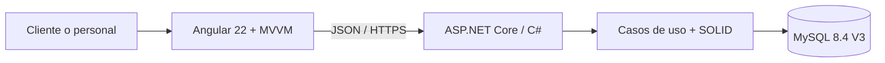

# Follow Motors

**Portal de asistencia, mantenimiento y posventa de motocicletas**  
Proyecto escolar de ingeniería de software del **equipo SSC**, desarrollado en GitHub con **Angular 22 + TypeScript (MVVM)**, **ASP.NET Core .NET 10 (C# y SOLID)** y **MySQL 8.4**.

> **Enfoque:** conservar el diseño y las pantallas de Fernando, aprovechar el esquema MySQL V3 de Gael y construir la funcionalidad de manera colaborativa. La versión anterior en [iokort.com/follow-motors](https://iokort.com/follow-motors) es referencia funcional: este repositorio no la despliega ni sobrescribe automáticamente.

## Navegación del proyecto

[Empresa y alcance](#la-empresa-y-el-producto) · [Equipo SSC](#quienes-somos) · [Tecnologías](#tecnologias-y-por-que) · [Arquitectura](#arquitectura-solid-y-mvvm) · [Épicas e historias CRC](#cuatro-epicas-historias-y-tarjetas-crc) · [Scrum](#plan-scrum-y-avance-real) · [Stakeholders](#stakeholders) · [Reglas y seguridad](#reglas-y-politicas) · [Ejecutar](#ejecucion-local)

## La empresa y el producto

**Follow Motors** se plantea como empresa de atención y seguimiento de motocicletas. El software ofrece un **portal de posventa**, no una tienda en línea: explica servicios, conecta con sucursal y permite a propietarios registrados consultar sus unidades y sus mantenimientos.

El recorrido del negocio es sencillo:

1. **En sucursal**, el gerente (que también actúa como asesor por ahora) verifica y registra cliente y motocicleta, y entrega sus credenciales.
2. El **cliente** inicia sesión para ver **solo** sus motocicletas vinculadas, sus servicios y su garantía. No registra motos ni cuentas desde internet.
3. Si requiere atención, **contacta por WhatsApp**; únicamente el personal autorizado captura la cita en la agenda.
4. La agenda admite también **motocicletas de otras marcas**. En el modelo MySQL V3 de Gael, estas se registran como citas externas, sin forzar su alta en el portal CFMOTO.
5. El **mecánico registra el trabajo** y el **gerente valida**. Si un servicio llega tarde, puede registrarse; el gerente decide si afecta la garantía y deja constancia del motivo.
6. Al terminar los **tres servicios** de garantía, esta finaliza, pero se permiten **mantenimientos posteriores cada seis meses**.

**Primera entrega escolar:** seguimiento de garantías, agenda y panel del cliente con sus unidades. Las demás funciones se priorizan en el backlog, sin declarar que ya estén terminadas.

[Reglas detalladas y excepciones](docs/reglas-negocio-ssc.md) · [Inventario de la versión original](docs/modulos.md).

## Quiénes somos

Somos **SSC**, cuatro estudiantes que colaboran por especialidad. Los cargos ayudan a repartir la gestión y la exposición; **no significan que cada integrante desarrolle solo su épica**.

| Integrante | Rol de equipo | Responsabilidad |
| --- | --- | --- |
| **Aarón** · [@Aaron262005](https://github.com/Aaron262005) | **Project Manager** | Planeación, Scrum, backlog, documentación, riesgos, evidencias |
| **Gael** · [@G43LEX](https://github.com/G43LEX) | **Database Manager** | Idea/enfoque funcional, modelo relacional y SQL MySQL V3 |
| **Vixtor Fernando** · [@fernandoohiti25](https://github.com/fernandoohiti25) | **Frontend Designer & Developer** | Diseño e interfaz, estilos, navegación y evolución a Angular |
| **Kort** · [@kortCobein](https://github.com/kortCobein) | **Backend Developer** | API C#/.NET, reglas, autenticación, permisos e integración técnica |

Aarón coordina el trabajo; Gael propone y aclara reglas del producto; Fernando es autor de la interfaz; Kort desarrolla backend y conecta las áreas. **Cada integrante explica el código o los documentos que realmente desarrolla.**

[Roles y matriz RACI](docs/stakeholders-ssc.md) · [Guía de contribución](CONTRIBUTING.md).

## Tecnologías y por qué

| Tecnología | Uso dentro de Follow Motors | Por qué fue elegida |
| --- | --- | --- |
| **Angular 22 + TypeScript** | Frontend, componentes, formularios y navegación | Organización visual mantenible, tipado y reutilización |
| **MVVM** | Separación de View, ViewModel y Model en Angular | Estado y acciones desacoplados de la vista |
| **C# / ASP.NET Core .NET 10** | API REST `/api/v1`, reglas de negocio y permisos | Validación en servidor, tipado y pruebas |
| **SOLID** | Diseño de servicios, políticas, repositorios e interfaces C# | Evitar clases monolíticas y acoplamiento innecesario |
| **MySQL 8.4** | Clientes, usuarios, motos, citas, trabajos y garantías | Claves, relaciones, integridad e historial transaccional |
| **GitHub / Actions / Projects** | Código, PR, revisiones, CI y Scrum/Kanban | Trazabilidad comprobable para el equipo escolar |

**Estado técnico actual:** Angular ya compila y aloja las **pantallas originales de Fernando mediante un adaptador**. El traslado progresivo de cada pantalla a componentes Angular nativos todavía está pendiente; no hemos reemplazado su diseño. Los **ocho scripts SQL V3 de Gael** ya están incorporados al repositorio, pero eso no demuestra que una base de datos productiva esté creada. La API C# tiene una base técnica y conexión de prueba a MySQL. **Las historias US06 y US15 disponen de backend C#** para registrar, consultar, reprogramar y cancelar citas con la base MySQL V3, permisos de personal, auditoría y pruebas. **No** está conectado aún con los formularios Angular de Fernando, ni se han implementado los demás módulos de negocio.

[Arquitectura y motivos](docs/arquitectura-objetivo-ssc.md) · [Frontend de Fernando integrado con Angular](frontend/README.md) · [Scripts SQL V3 de Gael](database/v3/sql/).

## Arquitectura, SOLID y MVVM



- **MVVM, frontend:** *View* = plantillas/pantallas de Fernando; *ViewModel* = estado, carga, errores y comandos con signals; *Model* = DTO y servicios HTTP. Actualmente existe una capa transitoria para las vistas JS originales.
- **SOLID, backend:** responsabilidades separadas entre controladores HTTP, reglas (citas, titularidad, mantenimiento, garantías) y adaptadores MySQL. Se crean interfaces solo cuando mejoran comprobación o desacoplamiento.
- **Autorización:** Angular no concede permisos; C# valida identidad, rol y propiedad de cada motocicleta. MySQL no se conecta directamente al navegador.
- **Persistencia:** se reutiliza el esquema V3 aportado por Gael; cambios sobre tablas existentes deben revisarse con él.

[Detalles, diagrama y ubicación de cada principio SOLID](docs/arquitectura-objetivo-ssc.md).

## Cuatro épicas, historias y tarjetas CRC

El plan priorizado se organiza en **4 épicas, 12 historias de usuario (3 por épica) y 144 tarjetas CRC (12 por historia)**. **Las tarjetas están dentro del archivo Markdown de su US**, con nombre, responsabilidad y colaboradores; no son 144 clases implementadas.

| Épica | Historias con sus 12 CRC por US | Resultado |
| --- | --- | --- |
| **[E01 · Identidad y permisos](docs/epicas/E01-identidad-acceso/README.md) [#43](https://github.com/iokort/Follow-Motors/issues/43)** | [US01](docs/epicas/E01-identidad-acceso/US01.md) · [US02](docs/epicas/E01-identidad-acceso/US02.md) · [US21](docs/epicas/E01-identidad-acceso/US21.md) | Acceso gerencial/cliente y autorización |
| **[E02 · Expedientes y unidades](docs/epicas/E02-expedientes-unidades/README.md) [#44](https://github.com/iokort/Follow-Motors/issues/44)** | [US04](docs/epicas/E02-expedientes-unidades/US04.md) · [US05](docs/epicas/E02-expedientes-unidades/US05.md) · [US13](docs/epicas/E02-expedientes-unidades/US13.md) | Altas y kilometraje confiable |
| **[E03 · Agenda y taller](docs/epicas/E03-agenda-operacion/README.md) [#45](https://github.com/iokort/Follow-Motors/issues/45)** | [US06](docs/epicas/E03-agenda-operacion/US06.md) · [US15](docs/epicas/E03-agenda-operacion/US15.md) · [US16](docs/epicas/E03-agenda-operacion/US16.md) | Citas internas y trabajos del taller |
| **[E04 · Garantías y cliente](docs/epicas/E04-mantenimiento-garantias-portal/README.md) [#46](https://github.com/iokort/Follow-Motors/issues/46)** | [US07](docs/epicas/E04-mantenimiento-garantias-portal/US07.md) · [US08](docs/epicas/E04-mantenimiento-garantias-portal/US08.md) · [US23](docs/epicas/E04-mantenimiento-garantias-portal/US23.md) | Tres servicios, garantía y consulta privada |

Cada historia enlaza su **Issue real**, criterios de aceptación y archivos relevantes del proyecto. Los otros elementos de la planificación original (22 US) siguen disponibles en [backlog V5](docs/backlog-v5.md) como referencia histórica; el [mapa priorizado de 12 historias](docs/epicas/README.md) es el que guía la primera entrega.

## Plan Scrum y avance real

Usaremos **Scrum con apoyo visual de GitHub Projects**. Se proponen sprints escolares de una semana, con planning, seguimientos breves, revisión y retrospectiva; Aarón documentará las fechas y evidencias **cuando realmente sucedan**. *Project Manager* es un cargo organizativo escolar, no un rol oficial de la Guía Scrum.

| Etapa | Objetivo |
| --- | --- |
| Preparación | Entorno Angular, API .NET y MySQL V3 reproducibles |
| Sprint 1 | Cuentas, permisos y alta presencial |
| Sprint 2 | Agenda de sucursal, incluyendo otras marcas |
| Sprint 3 | Seguimiento de servicios y decisiones de garantía |
| Sprint 4 | Panel cliente integrado y demo final |

Tablero real: **[Follow Motors — SSC](https://github.com/orgs/iokort/projects/1)**. Estados disponibles: `Sin Iniciar`, `Ready`, `Working`, `Waiting`, `Done` y `Canceled`. No atribuir progresos ni reuniones que no estén comprobados.

**Definition of Done:** criterios de la US probados, PR revisado e integrado, CI correcto, permisos verificados y evidencia enlazada.

**Avance de backend (E03):** [US06](docs/epicas/E03-agenda-operacion/US06.md) y [US15](docs/epicas/E03-agenda-operacion/US15.md) cuentan con [Controller, servicios SOLID, SQL y pruebas](backend/README.md). **Aún no se marcan como Done las historias completas** hasta validar la UI y el flujo real. Las pruebas automáticas de la base **no** significan que las funciones de negocio estén terminadas.

[Plan Scrum completo con tareas, iteraciones, DoR, DoD y riesgos](docs/scrum-plan-ssc.md) · [Issues](https://github.com/iokort/Follow-Motors/issues) · [Pull requests](https://github.com/iokort/Follow-Motors/pulls).

## Stakeholders

Identificamos como interesados principales al **gerente/asesor**, los **clientes propietarios**, los **mecánicos**, quienes solicitan citas con **motos de otras marcas**, los **cuatro integrantes SSC** y el **docente evaluador**. También afectan la seguridad y la operación la administración del negocio y el responsable de infraestructura.

La matriz RACI delimita quién ejecuta, aprueba, consulta y recibe información. No se declaran entrevistas ni validaciones empresariales que no hayan ocurrido.

[Stakeholders con interés, influencia y RACI](docs/stakeholders-ssc.md).

## Reglas y políticas

| Documento / sección | Qué establece |
| --- | --- |
| **[Reglas de negocio](docs/reglas-negocio-ssc.md)** | Registro presencial, WhatsApp, marcas externas, tres servicios, garantía y excepciones |
| **[Contribución](CONTRIBUTING.md)** | Ramas, Issues, PR, revisión de compañeros, contratos y pruebas |
| **[Seguridad](SECURITY.md)** | Sin contraseñas ni datos reales en GitHub, validación de permisos en C# y configuración segura |
| **[Plan Scrum](docs/scrum-plan-ssc.md)** | Sprints, Kanban, responsables, Definition of Ready y Done |
| **[Stakeholders y RACI](docs/stakeholders-ssc.md)** | Participantes, cargos, decisiones y responsabilidades |

**Decisión técnica todavía abierta:** Gael ha codificado en SQL V3 las etapas a los meses **3, 6 y 12 desde la venta**. La respuesta de negocio anterior puede interpretarse como **3 meses desde la venta, luego 6 y luego 12 meses entre servicios**. Antes de implementar la fórmula definitiva se debe acordar una sola interpretación **sin cambiar el SQL de Gael por cuenta propia**.

## Ejecución local

**Requisitos:** Git, Docker + Compose para API/MySQL, Node.js compatible con Angular 22 y, opcionalmente, .NET SDK 10 para ejecutar la API fuera de Docker.

```bash
git clone https://github.com/iokort/Follow-Motors.git
cd Follow-Motors
```

Configurar `.env` a partir de `.env.example` con contraseñas **locales propias**. Para API y MySQL:

```bash
docker compose up -d --build
```

Para frontend Angular, en otra terminal:

```bash
cd frontend
npm install
npm start
```

| Servicio | Dirección local |
| --- | --- |
| Angular | http://localhost:4200 |
| Salud API C# | http://localhost:5099/api/v1/health |
| Salud MySQL (solo Development) | http://localhost:5099/api/v1/health/database |
| MySQL local | 127.0.0.1:3307 |

Para verificar Angular: `npm run build` y `npm test` desde `frontend/`. **No usar datos personales reales para pruebas.** Los scripts de Gael están en `database/v3/sql/`; no suponer que se ejecutaron en una base remota.

## Seguridad y licencia

El repositorio es público y **no debe contener datos de clientes, contraseñas, respaldos ni secretos**. Toda autorización privada debe hacerse desde el backend. Los PR que afecten otras áreas necesitan coordinación y pruebas.

**Licencia:** por ahora el repositorio **no tiene un archivo `LICENSE` ni licencia de reutilización seleccionada**. No asumir que el código es de dominio público o que está automáticamente autorizado para uso externo; cualquier elección de licencia debe acordarse entre los autores.

---

© 2026 Kurt Cobain Vázquez Sánchez · [ioKort](https://iokort.com) · Proyecto académico **Follow Motors — SSC**.
