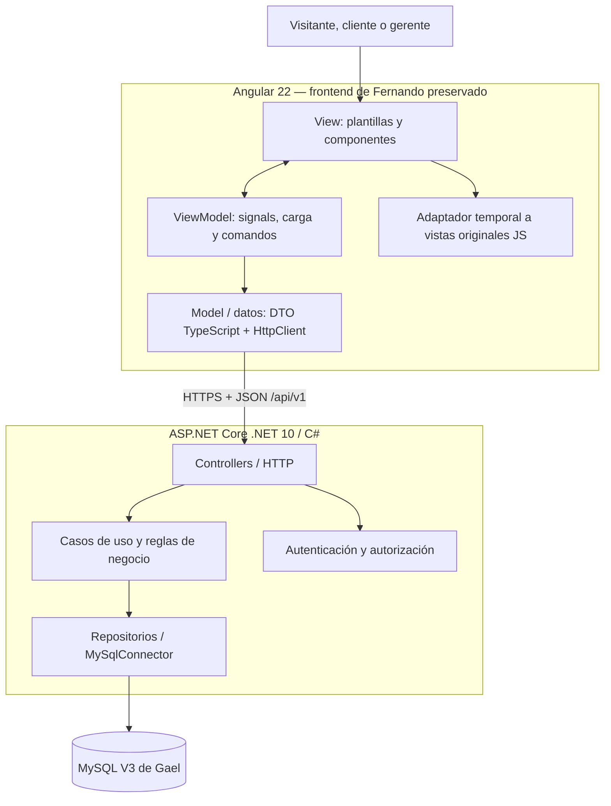

# Arquitectura técnica y justificación — Follow Motors

**Tecnologías elegidas: Angular 22/TypeScript, C#/ASP.NET Core .NET 10 y MySQL 8.4.** Se usa separación MVVM en presentación y principios SOLID en backend. No son patrones excluyentes.

## Flujo entre capas

## Por qué cada tecnología

| Elección | Motivo aplicado al proyecto | Trabajo actual |
| --- | --- | --- |
| **Angular 22 + TypeScript** | Componentes reutilizables, tipado de contratos, formularios, rutas y un frontend mantenible | Entorno Angular añadido sin borrar la interfaz de Fernando |
| **MVVM** | Separa estado/comandos del HTML, simplifica mostrar carga, errores y datos | ViewModel de integración; portar progresivamente vistas JS sin rediseñar |
| **ASP.NET Core .NET 10 (C#)** | API REST con tipado, middleware de seguridad y buenas herramientas de prueba | API de salud y conexión a MySQL; lógica de negocio pendiente |
| **SOLID** | Mantener una responsabilidad por clase y probar reglas sin acoplar HTTP/SQL | Aplicar cuando existan servicios de identidad, citas y garantía |
| **MySQL 8.4** | Relaciones, claves únicas, integridad y transacciones para clientes, citas y servicios | Esquema V3 de Gael versionado; ejecución real pendiente de confirmar |
| **Scrum + GitHub Projects** | Distribuir trabajo por historias y mostrar avances verificables | Plan, 4 épicas, 12 US, 144 fichas CRC y tablero |

## Uso concreto de SOLID

| Principio | Dónde se aplica |
| --- | --- |
| **S** — Single Responsibility | Controlador recibe HTTP; caso de uso aplica regla; repositorio persiste; ViewModel presenta |
| **O** — Open/Closed | Política versionable de mantenimiento, sin alterar historial cada vez que cambie regla |
| **L** — Liskov Substitution | Adaptadores de repositorio cumplen los contratos que utilizan casos de uso |
| **I** — Interface Segregation | Contratos específicos para citas, motos o trabajos en lugar de servicios gigantes |
| **D** — Dependency Inversion | Casos de uso dependen de contratos; conexión MySQL y HTTP son detalles externos |

**Sin sobreingeniería:** no crear repositorios o interfaces que no se necesiten; las 144 fichas CRC son ideas de diseño, no 144 clases obligatorias.

## MVVM de frontend con el código real de Fernando

- **View:** plantillas Angular y HTML/CSS original; respetar composición visual creada por Fernando.
- **ViewModel:** objetos con estado y comandos observables mediante signals; `frontend/src/app/viewmodels/app.viewmodel.ts` ya existe.
- **Model:** DTO y servicios `HttpClient`; datos de prueba originales **no equivalen a MySQL**.
- **Transición:** `frontend/src/app/services/legacy-ui.service.ts` carga las pantallas JS originales. La transición a componentes Angular nativos se hace por módulos y con verificación visual antes/después, sin sustituir su diseño.

## Qué comunica cada persona

Fernando enseña estilos, vistas y migración MVVM; Gael muestra entidades/tablas, PK/FK y scripts; Kort explica servicios C#, validación, contratos y seguridad; Aarón presenta planificación, interesados, historias, CRC y estado real de Scrum.

## Recursos técnicos comprobables

- [Scripts MySQL V3 de Gael](../database/v3/sql/)
- [Frontend Angular y diseño original de Fernando](../frontend/)
- [Backend ASP.NET Core](../backend/FollowMotors.Api/)
- [Especificación del backlog](epicas/README.md)
- [Reglas de negocio](reglas-negocio-ssc.md)

## Fuentes

Angular. (s. f.). *Angular documentation*. https://angular.dev/

Microsoft. (s. f.). *ASP.NET Core documentation*. https://learn.microsoft.com/aspnet/core/

Oracle. (s. f.). *MySQL 8.4 reference manual*. https://dev.mysql.com/doc/refman/8.4/en/

Martin, R. C. (2017). *Clean architecture: A craftsman's guide to software structure and design*. Prentice Hall.

## Caso aplicado de SOLID: agenda (US06 y US15)

- **Controller:** `backend/FollowMotors.Api/Controllers/CitasController.cs` — entrada HTTP y permisos, sin SQL.
- **Servicio de aplicación:** `Application/Agenda/AgendaService.cs` — casos de uso y transiciones.
- **Política de dominio:** `Application/Agenda/AgendaPolicy.cs` — validaciones reutilizables sin HTTP.
- **Contrato:** `IAgendaRepository` — dependencia invertida; permite fake de pruebas.
- **Adaptador MySQL:** `Infrastructure/Agenda/MySqlAgendaRepository.cs` — SQL parametrizado y auditoría.
- **Pruebas:** `backend/FollowMotors.Api.Specs/` — reglas y, en CI, integración temporal de los scripts V3.

Estas rutas no significan que la UI de Fernando esté conectada ni que exista sesión de gerente aprovisionada fuera de pruebas.
