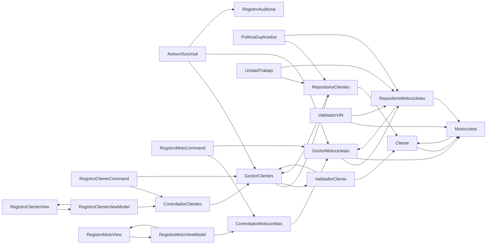

# US04 — Alta presencial por asesor de sucursal

**Objetivo:** Verificar y registrar cliente y moto en sucursal con permisos explícitos, trazabilidad e integridad.  
**Estado:** propuesta de análisis para el equipo SSC; **no se afirma implementación**.  
**Fichas:** 20 componentes o conceptos seleccionados para US04, reutilizando definiciones del catálogo general.

[Volver al índice de CRC](README.md) · [Backlog V5](../backlog-v5.md) · [MVVM y arquitectura](../mvvm-y-arquitectura.md)

## Índice de las 20 fichas

| N.º | Clase / componente | Tipo |
| ---: | --- | --- |
| 01 | [Cliente](#crc-us04-01) | Entidad |
| 02 | [Motocicleta](#crc-us04-02) | Entidad de dominio |
| 03 | [AsesorSucursal](#crc-us04-03) | Rol / actor autorizado |
| 04 | [GestorClientes](#crc-us04-04) | Caso de uso |
| 05 | [GestorMotocicletas](#crc-us04-05) | Caso de uso |
| 06 | [RepositorioClientes](#crc-us04-06) | Puerto / repositorio |
| 07 | [RepositorioMotocicletas](#crc-us04-07) | Puerto / repositorio |
| 08 | [ValidadorCliente](#crc-us04-08) | Validador |
| 09 | [ValidadorVIN](#crc-us04-09) | Validador |
| 10 | [PoliticaDuplicados](#crc-us04-10) | Política de dominio |
| 11 | [RegistroClienteCommand](#crc-us04-11) | DTO de aplicación |
| 12 | [RegistroMotoCommand](#crc-us04-12) | DTO de aplicación |
| 13 | [ControladorClientes](#crc-us04-13) | Controlador HTTP |
| 14 | [ControladorMotocicletas](#crc-us04-14) | Controlador HTTP |
| 15 | [RegistroClienteView](#crc-us04-15) | Vista MVVM |
| 16 | [RegistroClienteViewModel](#crc-us04-16) | ViewModel |
| 17 | [RegistroMotoView](#crc-us04-17) | Vista MVVM |
| 18 | [RegistroMotoViewModel](#crc-us04-18) | ViewModel |
| 19 | [UnidadTrabajo](#crc-us04-19) | Puerto transaccional |
| 20 | [RegistroAuditoria](#crc-us04-20) | Servicio de infraestructura |

## Mapa de colaboraciones — vista de alto nivel

*Flechas calculadas a partir de los colaboradores explícitos de las fichas CRC. Los roles no se confunden con entidades.*

## Tarjetas CRC

### CRC-US04-01 · Cliente

| Campo | Especificación de diseño |
| --- | --- |
| **Tipo** | Entidad |
| **Responsabilidad** | Representar un expediente de cliente y su relación con motocicletas propias. |
| **Colaboradores** | `Usuario` · `Motocicleta` |
| **SOLID aplicado** | SRP — Mantiene invariantes propias sin responsabilidades de interfaz o acceso a datos. |
| **Límite de responsabilidad** | Separar decisiones de dominio de navegación y almacenamiento. |
| **Vinculación** | US04; validar en implementación y prueba antes de marcar completada. |

### CRC-US04-02 · Motocicleta

| Campo | Especificación de diseño |
| --- | --- |
| **Tipo** | Entidad de dominio |
| **Responsabilidad** | Representar VIN, modelo, propiedad y vínculos al historial sin renderizar HTML. |
| **Colaboradores** | `Cliente` · `RegistroServicio` |
| **SOLID aplicado** | SRP — Mantiene invariantes propias sin responsabilidades de interfaz o acceso a datos. |
| **Límite de responsabilidad** | Separar decisiones de dominio de navegación y almacenamiento. |
| **Vinculación** | US04; validar en implementación y prueba antes de marcar completada. |

### CRC-US04-03 · AsesorSucursal

| Campo | Especificación de diseño |
| --- | --- |
| **Tipo** | Rol / actor autorizado |
| **Responsabilidad** | Verificar identidad y propiedad en sucursal antes de iniciar alta, actuando solo dentro de los permisos otorgados. |
| **Colaboradores** | `GestorClientes` · `GestorMotocicletas` · `RegistroAuditoria` |
| **SOLID aplicado** | SRP — El asesor es un rol de operación; su autorización se valida por separado en el backend. |
| **Límite de responsabilidad** | No es un cliente ni puede habilitar permisos administrativos fuera de su alcance. |
| **Vinculación** | US04; validar en implementación y prueba antes de marcar completada. |

### CRC-US04-04 · GestorClientes

| Campo | Especificación de diseño |
| --- | --- |
| **Tipo** | Caso de uso |
| **Responsabilidad** | Orquestar registro, consulta y edición autorizada de clientes. |
| **Colaboradores** | `RepositorioClientes` · `ValidadorCliente` |
| **SOLID aplicado** | SRP + DIP — Encapsula una capacidad y colabora por interfaces cuando depende de infraestructura. |
| **Límite de responsabilidad** | Separar decisiones de dominio de navegación y almacenamiento. |
| **Vinculación** | US04; validar en implementación y prueba antes de marcar completada. |

### CRC-US04-05 · GestorMotocicletas

| Campo | Especificación de diseño |
| --- | --- |
| **Tipo** | Caso de uso |
| **Responsabilidad** | Orquestar alta, vínculo y consulta de unidades con control de duplicados. |
| **Colaboradores** | `RepositorioMotocicletas` · `Motocicleta` |
| **SOLID aplicado** | SRP + DIP — Encapsula una capacidad y colabora por interfaces cuando depende de infraestructura. |
| **Límite de responsabilidad** | Separar decisiones de dominio de navegación y almacenamiento. |
| **Vinculación** | US04; validar en implementación y prueba antes de marcar completada. |

### CRC-US04-06 · RepositorioClientes

| Campo | Especificación de diseño |
| --- | --- |
| **Tipo** | Puerto / repositorio |
| **Responsabilidad** | Persistir y consultar expedientes de clientes sin exponer SQL a casos de uso. |
| **Colaboradores** | `Cliente` · `GestorClientes` |
| **SOLID aplicado** | DIP — El caso de uso consume un contrato; MySQL y sus consultas quedan en un adaptador. |
| **Límite de responsabilidad** | MySQL se mantiene detrás de una interfaz; no exponer tablas a la UI. |
| **Vinculación** | US04; validar en implementación y prueba antes de marcar completada. |

### CRC-US04-07 · RepositorioMotocicletas

| Campo | Especificación de diseño |
| --- | --- |
| **Tipo** | Puerto / repositorio |
| **Responsabilidad** | Acceder a motocicletas y su relación con propietario vía contrato. |
| **Colaboradores** | `Motocicleta` · `GestorMotocicletas` |
| **SOLID aplicado** | DIP — El caso de uso consume un contrato; MySQL y sus consultas quedan en un adaptador. |
| **Límite de responsabilidad** | MySQL se mantiene detrás de una interfaz; no exponer tablas a la UI. |
| **Vinculación** | US04; validar en implementación y prueba antes de marcar completada. |

### CRC-US04-08 · ValidadorCliente

| Campo | Especificación de diseño |
| --- | --- |
| **Tipo** | Validador |
| **Responsabilidad** | Comprobar formato, campos necesarios y reglas del expediente cliente. |
| **Colaboradores** | `Cliente` · `GestorClientes` |
| **SOLID aplicado** | SRP — Responsabilidad delimitada y colaboración explícita. |
| **Límite de responsabilidad** | Separar decisiones de dominio de navegación y almacenamiento. |
| **Vinculación** | US04; validar en implementación y prueba antes de marcar completada. |

### CRC-US04-09 · ValidadorVIN

| Campo | Especificación de diseño |
| --- | --- |
| **Tipo** | Validador |
| **Responsabilidad** | Normalizar y validar identificadores de vehículo antes de persistir. |
| **Colaboradores** | `Motocicleta` · `RepositorioMotocicletas` |
| **SOLID aplicado** | SRP — Responsabilidad delimitada y colaboración explícita. |
| **Límite de responsabilidad** | Separar decisiones de dominio de navegación y almacenamiento. |
| **Vinculación** | US04; validar en implementación y prueba antes de marcar completada. |

### CRC-US04-10 · PoliticaDuplicados

| Campo | Especificación de diseño |
| --- | --- |
| **Tipo** | Política de dominio |
| **Responsabilidad** | Detectar conflictos de identidad y evitar duplicaciones al guardar expedientes. |
| **Colaboradores** | `RepositorioClientes` · `RepositorioMotocicletas` |
| **SOLID aplicado** | OCP + SRP — La regla se concentra y puede sustituirse por otra estrategia cuando cambie el negocio. |
| **Límite de responsabilidad** | Los parámetros o reglas de negocio requieren validación y pueden cambiar. |
| **Vinculación** | US04; validar en implementación y prueba antes de marcar completada. |

### CRC-US04-11 · RegistroClienteCommand

| Campo | Especificación de diseño |
| --- | --- |
| **Tipo** | DTO de aplicación |
| **Responsabilidad** | Transportar únicamente campos necesarios para registrar cliente. |
| **Colaboradores** | `ControladorClientes` · `GestorClientes` |
| **SOLID aplicado** | ISP — Contrato de entrada específico con solo los datos que requiere una operación. |
| **Límite de responsabilidad** | Separar decisiones de dominio de navegación y almacenamiento. |
| **Vinculación** | US04; validar en implementación y prueba antes de marcar completada. |

### CRC-US04-12 · RegistroMotoCommand

| Campo | Especificación de diseño |
| --- | --- |
| **Tipo** | DTO de aplicación |
| **Responsabilidad** | Transportar datos mínimos de motocicleta y referencia de propietario. |
| **Colaboradores** | `ControladorMotocicletas` · `GestorMotocicletas` |
| **SOLID aplicado** | ISP — Contrato de entrada específico con solo los datos que requiere una operación. |
| **Límite de responsabilidad** | Separar decisiones de dominio de navegación y almacenamiento. |
| **Vinculación** | US04; validar en implementación y prueba antes de marcar completada. |

### CRC-US04-13 · ControladorClientes

| Campo | Especificación de diseño |
| --- | --- |
| **Tipo** | Controlador HTTP |
| **Responsabilidad** | Exponer alta, búsqueda y corrección de clientes sin lógica SQL directa. |
| **Colaboradores** | `GestorClientes` · `AutorizadorRecurso` |
| **SOLID aplicado** | SRP — Traduce HTTP en solicitudes de aplicación; no mezcla reglas ni consultas directas. |
| **Límite de responsabilidad** | El controlador delega reglas al caso de uso. |
| **Vinculación** | US04; validar en implementación y prueba antes de marcar completada. |

### CRC-US04-14 · ControladorMotocicletas

| Campo | Especificación de diseño |
| --- | --- |
| **Tipo** | Controlador HTTP |
| **Responsabilidad** | Exponer altas y consultas de motocicletas con validación y permisos. |
| **Colaboradores** | `GestorMotocicletas` · `AutorizadorRecurso` |
| **SOLID aplicado** | SRP — Traduce HTTP en solicitudes de aplicación; no mezcla reglas ni consultas directas. |
| **Límite de responsabilidad** | El controlador delega reglas al caso de uso. |
| **Vinculación** | US04; validar en implementación y prueba antes de marcar completada. |

### CRC-US04-15 · RegistroClienteView

| Campo | Especificación de diseño |
| --- | --- |
| **Tipo** | Vista MVVM |
| **Responsabilidad** | Mostrar el formulario de cliente con indicadores de validación. |
| **Colaboradores** | `RegistroClienteViewModel` |
| **SOLID aplicado** | SRP — Solo presenta información y captura interacción; no implementa autorización ni SQL. |
| **Límite de responsabilidad** | La vista no autoriza acciones ni habla con MySQL. |
| **Vinculación** | US04; validar en implementación y prueba antes de marcar completada. |

### CRC-US04-16 · RegistroClienteViewModel

| Campo | Especificación de diseño |
| --- | --- |
| **Tipo** | ViewModel |
| **Responsabilidad** | Preparar campos y estados del formulario de cliente y consumir su API. |
| **Colaboradores** | `RegistroClienteView` · `ControladorClientes` |
| **SOLID aplicado** | SRP + DIP — Gestiona estado de presentación; usa un cliente de datos en lugar de acceder a persistencia. |
| **Límite de responsabilidad** | No debe contener lógica de permisos ni persistencia. |
| **Vinculación** | US04; validar en implementación y prueba antes de marcar completada. |

### CRC-US04-17 · RegistroMotoView

| Campo | Especificación de diseño |
| --- | --- |
| **Tipo** | Vista MVVM |
| **Responsabilidad** | Mostrar formulario de unidad y vínculo de cliente. |
| **Colaboradores** | `RegistroMotoViewModel` |
| **SOLID aplicado** | SRP — Solo presenta información y captura interacción; no implementa autorización ni SQL. |
| **Límite de responsabilidad** | La vista no autoriza acciones ni habla con MySQL. |
| **Vinculación** | US04; validar en implementación y prueba antes de marcar completada. |

### CRC-US04-18 · RegistroMotoViewModel

| Campo | Especificación de diseño |
| --- | --- |
| **Tipo** | ViewModel |
| **Responsabilidad** | Gestionar entrada, errores y resultado del registro de motocicleta. |
| **Colaboradores** | `RegistroMotoView` · `ControladorMotocicletas` |
| **SOLID aplicado** | SRP + DIP — Gestiona estado de presentación; usa un cliente de datos en lugar de acceder a persistencia. |
| **Límite de responsabilidad** | No debe contener lógica de permisos ni persistencia. |
| **Vinculación** | US04; validar en implementación y prueba antes de marcar completada. |

### CRC-US04-19 · UnidadTrabajo

| Campo | Especificación de diseño |
| --- | --- |
| **Tipo** | Puerto transaccional |
| **Responsabilidad** | Agrupar operaciones dependientes en una transacción consistente. |
| **Colaboradores** | `RepositorioClientes` · `RepositorioMotocicletas` |
| **SOLID aplicado** | DIP — El caso de uso consume un contrato; MySQL y sus consultas quedan en un adaptador. |
| **Límite de responsabilidad** | MySQL se mantiene detrás de una interfaz; no exponer tablas a la UI. |
| **Vinculación** | US04; validar en implementación y prueba antes de marcar completada. |

### CRC-US04-20 · RegistroAuditoria

| Campo | Especificación de diseño |
| --- | --- |
| **Tipo** | Servicio de infraestructura |
| **Responsabilidad** | Conservar eventos sensibles con actor, momento y recurso sin datos secretos. |
| **Colaboradores** | `AutenticacionServicio` · `GestorMantenimiento` |
| **SOLID aplicado** | SRP + DIP — Encapsula una capacidad y colabora por interfaces cuando depende de infraestructura. |
| **Límite de responsabilidad** | Separar decisiones de dominio de navegación y almacenamiento. |
| **Vinculación** | US04; validar en implementación y prueba antes de marcar completada. |

## Validación de diseño

- [ ] Confirmar qué elementos requieren clase concreta, función, interfaz o DTO.
- [ ] Comprobar SRP: cada componente responde a un tipo de cambio.
- [ ] Verificar que los colaboradores realmente sean necesarios y que el dominio no importe la vista.
- [ ] Validar contratos con @kortCobein, @G43LEX y @fernandoohiti25 cuando cambien API o datos.
- [ ] Vincular implementación, pruebas y revisión al Issue de US04; registrar ajustes en el ADR.
