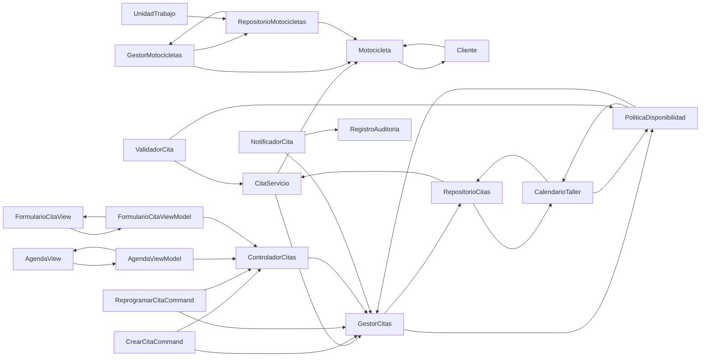

# US06 — Agenda de citas del taller

**Objetivo:** Crear y reprogramar citas según motocicleta, horario y disponibilidad.  
**Estado:** propuesta de análisis para el equipo SSC; **no se afirma implementación**.  
**Fichas:** 20 componentes o conceptos seleccionados para US06, reutilizando definiciones del catálogo general.

[Volver al índice de CRC](README.md) · [Backlog V5](../backlog-v5.md) · [MVVM y arquitectura](../mvvm-y-arquitectura.md)

## Índice de las 20 fichas

| N.º | Clase / componente | Tipo |
| ---: | --- | --- |
| 01 | [CitaServicio](#crc-us06-01) | Entidad de dominio |
| 02 | [GestorCitas](#crc-us06-02) | Caso de uso |
| 03 | [Cliente](#crc-us06-03) | Entidad |
| 04 | [Motocicleta](#crc-us06-04) | Entidad de dominio |
| 05 | [GestorMotocicletas](#crc-us06-05) | Caso de uso |
| 06 | [RepositorioCitas](#crc-us06-06) | Puerto / repositorio |
| 07 | [RepositorioMotocicletas](#crc-us06-07) | Puerto / repositorio |
| 08 | [PoliticaDisponibilidad](#crc-us06-08) | Política de dominio |
| 09 | [CalendarioTaller](#crc-us06-09) | Modelo de dominio |
| 10 | [ValidadorCita](#crc-us06-10) | Validador |
| 11 | [CrearCitaCommand](#crc-us06-11) | DTO de aplicación |
| 12 | [ReprogramarCitaCommand](#crc-us06-12) | DTO de aplicación |
| 13 | [ControladorCitas](#crc-us06-13) | Controlador HTTP |
| 14 | [AgendaView](#crc-us06-14) | Vista MVVM |
| 15 | [AgendaViewModel](#crc-us06-15) | ViewModel |
| 16 | [FormularioCitaView](#crc-us06-16) | Vista MVVM |
| 17 | [FormularioCitaViewModel](#crc-us06-17) | ViewModel |
| 18 | [NotificadorCita](#crc-us06-18) | Puerto opcional |
| 19 | [RegistroAuditoria](#crc-us06-19) | Servicio de infraestructura |
| 20 | [UnidadTrabajo](#crc-us06-20) | Puerto transaccional |

## Mapa de colaboraciones — vista de alto nivel

*Flechas calculadas a partir de los colaboradores explícitos de las fichas CRC. Los roles no se confunden con entidades.*

## Tarjetas CRC

### CRC-US06-01 · CitaServicio

| Campo | Especificación de diseño |
| --- | --- |
| **Tipo** | Entidad de dominio |
| **Responsabilidad** | Representar fecha, motivo, estado y motocicleta vinculada a una cita. |
| **Colaboradores** | `Motocicleta` · `GestorCitas` |
| **SOLID aplicado** | SRP — Mantiene invariantes propias sin responsabilidades de interfaz o acceso a datos. |
| **Límite de responsabilidad** | Separar decisiones de dominio de navegación y almacenamiento. |
| **Vinculación** | US06; validar en implementación y prueba antes de marcar completada. |

### CRC-US06-02 · GestorCitas

| Campo | Especificación de diseño |
| --- | --- |
| **Tipo** | Caso de uso |
| **Responsabilidad** | Registrar, buscar y reprogramar citas respetando política de disponibilidad. |
| **Colaboradores** | `RepositorioCitas` · `PoliticaDisponibilidad` |
| **SOLID aplicado** | SRP + DIP — Encapsula una capacidad y colabora por interfaces cuando depende de infraestructura. |
| **Límite de responsabilidad** | Separar decisiones de dominio de navegación y almacenamiento. |
| **Vinculación** | US06; validar en implementación y prueba antes de marcar completada. |

### CRC-US06-03 · Cliente

| Campo | Especificación de diseño |
| --- | --- |
| **Tipo** | Entidad |
| **Responsabilidad** | Representar un expediente de cliente y su relación con motocicletas propias. |
| **Colaboradores** | `Usuario` · `Motocicleta` |
| **SOLID aplicado** | SRP — Mantiene invariantes propias sin responsabilidades de interfaz o acceso a datos. |
| **Límite de responsabilidad** | Separar decisiones de dominio de navegación y almacenamiento. |
| **Vinculación** | US06; validar en implementación y prueba antes de marcar completada. |

### CRC-US06-04 · Motocicleta

| Campo | Especificación de diseño |
| --- | --- |
| **Tipo** | Entidad de dominio |
| **Responsabilidad** | Representar VIN, modelo, propiedad y vínculos al historial sin renderizar HTML. |
| **Colaboradores** | `Cliente` · `RegistroServicio` |
| **SOLID aplicado** | SRP — Mantiene invariantes propias sin responsabilidades de interfaz o acceso a datos. |
| **Límite de responsabilidad** | Separar decisiones de dominio de navegación y almacenamiento. |
| **Vinculación** | US06; validar en implementación y prueba antes de marcar completada. |

### CRC-US06-05 · GestorMotocicletas

| Campo | Especificación de diseño |
| --- | --- |
| **Tipo** | Caso de uso |
| **Responsabilidad** | Orquestar alta, vínculo y consulta de unidades con control de duplicados. |
| **Colaboradores** | `RepositorioMotocicletas` · `Motocicleta` |
| **SOLID aplicado** | SRP + DIP — Encapsula una capacidad y colabora por interfaces cuando depende de infraestructura. |
| **Límite de responsabilidad** | Separar decisiones de dominio de navegación y almacenamiento. |
| **Vinculación** | US06; validar en implementación y prueba antes de marcar completada. |

### CRC-US06-06 · RepositorioCitas

| Campo | Especificación de diseño |
| --- | --- |
| **Tipo** | Puerto / repositorio |
| **Responsabilidad** | Persistir citas y consultar intervalos ocupados con interfaz estable. |
| **Colaboradores** | `CitaServicio` · `CalendarioTaller` |
| **SOLID aplicado** | DIP — El caso de uso consume un contrato; MySQL y sus consultas quedan en un adaptador. |
| **Límite de responsabilidad** | MySQL se mantiene detrás de una interfaz; no exponer tablas a la UI. |
| **Vinculación** | US06; validar en implementación y prueba antes de marcar completada. |

### CRC-US06-07 · RepositorioMotocicletas

| Campo | Especificación de diseño |
| --- | --- |
| **Tipo** | Puerto / repositorio |
| **Responsabilidad** | Acceder a motocicletas y su relación con propietario vía contrato. |
| **Colaboradores** | `Motocicleta` · `GestorMotocicletas` |
| **SOLID aplicado** | DIP — El caso de uso consume un contrato; MySQL y sus consultas quedan en un adaptador. |
| **Límite de responsabilidad** | MySQL se mantiene detrás de una interfaz; no exponer tablas a la UI. |
| **Vinculación** | US06; validar en implementación y prueba antes de marcar completada. |

### CRC-US06-08 · PoliticaDisponibilidad

| Campo | Especificación de diseño |
| --- | --- |
| **Tipo** | Política de dominio |
| **Responsabilidad** | Determinar si un horario cumple capacidad y reglas aprobadas del taller. |
| **Colaboradores** | `CalendarioTaller` · `GestorCitas` |
| **SOLID aplicado** | OCP + SRP — La regla se concentra y puede sustituirse por otra estrategia cuando cambie el negocio. |
| **Límite de responsabilidad** | Los parámetros o reglas de negocio requieren validación y pueden cambiar. |
| **Vinculación** | US06; validar en implementación y prueba antes de marcar completada. |

### CRC-US06-09 · CalendarioTaller

| Campo | Especificación de diseño |
| --- | --- |
| **Tipo** | Modelo de dominio |
| **Responsabilidad** | Representar espacios ocupados y fechas sin decidir quién tiene acceso. |
| **Colaboradores** | `RepositorioCitas` · `PoliticaDisponibilidad` |
| **SOLID aplicado** | SRP — Responsabilidad delimitada y colaboración explícita. |
| **Límite de responsabilidad** | Separar decisiones de dominio de navegación y almacenamiento. |
| **Vinculación** | US06; validar en implementación y prueba antes de marcar completada. |

### CRC-US06-10 · ValidadorCita

| Campo | Especificación de diseño |
| --- | --- |
| **Tipo** | Validador |
| **Responsabilidad** | Comprobar campos, intervalos y datos de moto antes de agendar. |
| **Colaboradores** | `CitaServicio` · `PoliticaDisponibilidad` |
| **SOLID aplicado** | SRP — Responsabilidad delimitada y colaboración explícita. |
| **Límite de responsabilidad** | Separar decisiones de dominio de navegación y almacenamiento. |
| **Vinculación** | US06; validar en implementación y prueba antes de marcar completada. |

### CRC-US06-11 · CrearCitaCommand

| Campo | Especificación de diseño |
| --- | --- |
| **Tipo** | DTO de aplicación |
| **Responsabilidad** | Representar la intención de crear cita con fecha, motivo y moto. |
| **Colaboradores** | `ControladorCitas` · `GestorCitas` |
| **SOLID aplicado** | ISP — Contrato de entrada específico con solo los datos que requiere una operación. |
| **Límite de responsabilidad** | Separar decisiones de dominio de navegación y almacenamiento. |
| **Vinculación** | US06; validar en implementación y prueba antes de marcar completada. |

### CRC-US06-12 · ReprogramarCitaCommand

| Campo | Especificación de diseño |
| --- | --- |
| **Tipo** | DTO de aplicación |
| **Responsabilidad** | Representar cambio de cita indicando identificador y nueva franja. |
| **Colaboradores** | `ControladorCitas` · `GestorCitas` |
| **SOLID aplicado** | ISP — Contrato de entrada específico con solo los datos que requiere una operación. |
| **Límite de responsabilidad** | Separar decisiones de dominio de navegación y almacenamiento. |
| **Vinculación** | US06; validar en implementación y prueba antes de marcar completada. |

### CRC-US06-13 · ControladorCitas

| Campo | Especificación de diseño |
| --- | --- |
| **Tipo** | Controlador HTTP |
| **Responsabilidad** | Exponer agenda y modificaciones de cita a roles autorizados. |
| **Colaboradores** | `GestorCitas` · `AutorizadorRecurso` |
| **SOLID aplicado** | SRP — Traduce HTTP en solicitudes de aplicación; no mezcla reglas ni consultas directas. |
| **Límite de responsabilidad** | El controlador delega reglas al caso de uso. |
| **Vinculación** | US06; validar en implementación y prueba antes de marcar completada. |

### CRC-US06-14 · AgendaView

| Campo | Especificación de diseño |
| --- | --- |
| **Tipo** | Vista MVVM |
| **Responsabilidad** | Dibujar agenda y accesos de operaciones permitidas. |
| **Colaboradores** | `AgendaViewModel` |
| **SOLID aplicado** | SRP — Solo presenta información y captura interacción; no implementa autorización ni SQL. |
| **Límite de responsabilidad** | La vista no autoriza acciones ni habla con MySQL. |
| **Vinculación** | US06; validar en implementación y prueba antes de marcar completada. |

### CRC-US06-15 · AgendaViewModel

| Campo | Especificación de diseño |
| --- | --- |
| **Tipo** | ViewModel |
| **Responsabilidad** | Administrar semana seleccionada, carga, filtros y resultados de agenda. |
| **Colaboradores** | `AgendaView` · `ControladorCitas` |
| **SOLID aplicado** | SRP + DIP — Gestiona estado de presentación; usa un cliente de datos en lugar de acceder a persistencia. |
| **Límite de responsabilidad** | No debe contener lógica de permisos ni persistencia. |
| **Vinculación** | US06; validar en implementación y prueba antes de marcar completada. |

### CRC-US06-16 · FormularioCitaView

| Campo | Especificación de diseño |
| --- | --- |
| **Tipo** | Vista MVVM |
| **Responsabilidad** | Presentar campos de cita y conflictos con accesibilidad. |
| **Colaboradores** | `FormularioCitaViewModel` |
| **SOLID aplicado** | SRP — Solo presenta información y captura interacción; no implementa autorización ni SQL. |
| **Límite de responsabilidad** | La vista no autoriza acciones ni habla con MySQL. |
| **Vinculación** | US06; validar en implementación y prueba antes de marcar completada. |

### CRC-US06-17 · FormularioCitaViewModel

| Campo | Especificación de diseño |
| --- | --- |
| **Tipo** | ViewModel |
| **Responsabilidad** | Gestionar creación y reprogramación sin validar capacidad localmente como autoridad. |
| **Colaboradores** | `FormularioCitaView` · `ControladorCitas` |
| **SOLID aplicado** | SRP + DIP — Gestiona estado de presentación; usa un cliente de datos en lugar de acceder a persistencia. |
| **Límite de responsabilidad** | No debe contener lógica de permisos ni persistencia. |
| **Vinculación** | US06; validar en implementación y prueba antes de marcar completada. |

### CRC-US06-18 · NotificadorCita

| Campo | Especificación de diseño |
| --- | --- |
| **Tipo** | Puerto opcional |
| **Responsabilidad** | Solicitar aviso de cambio de cita solo después de registrar la operación. |
| **Colaboradores** | `GestorCitas` · `RegistroAuditoria` |
| **SOLID aplicado** | DIP — El caso de uso consume un contrato; MySQL y sus consultas quedan en un adaptador. |
| **Límite de responsabilidad** | MySQL se mantiene detrás de una interfaz; no exponer tablas a la UI. |
| **Vinculación** | US06; validar en implementación y prueba antes de marcar completada. |

### CRC-US06-19 · RegistroAuditoria

| Campo | Especificación de diseño |
| --- | --- |
| **Tipo** | Servicio de infraestructura |
| **Responsabilidad** | Conservar eventos sensibles con actor, momento y recurso sin datos secretos. |
| **Colaboradores** | `AutenticacionServicio` · `GestorMantenimiento` |
| **SOLID aplicado** | SRP + DIP — Encapsula una capacidad y colabora por interfaces cuando depende de infraestructura. |
| **Límite de responsabilidad** | Separar decisiones de dominio de navegación y almacenamiento. |
| **Vinculación** | US06; validar en implementación y prueba antes de marcar completada. |

### CRC-US06-20 · UnidadTrabajo

| Campo | Especificación de diseño |
| --- | --- |
| **Tipo** | Puerto transaccional |
| **Responsabilidad** | Agrupar operaciones dependientes en una transacción consistente. |
| **Colaboradores** | `RepositorioClientes` · `RepositorioMotocicletas` |
| **SOLID aplicado** | DIP — El caso de uso consume un contrato; MySQL y sus consultas quedan en un adaptador. |
| **Límite de responsabilidad** | MySQL se mantiene detrás de una interfaz; no exponer tablas a la UI. |
| **Vinculación** | US06; validar en implementación y prueba antes de marcar completada. |

## Validación de diseño

- [ ] Confirmar qué elementos requieren clase concreta, función, interfaz o DTO.
- [ ] Comprobar SRP: cada componente responde a un tipo de cambio.
- [ ] Verificar que los colaboradores realmente sean necesarios y que el dominio no importe la vista.
- [ ] Validar contratos con @kortCobein, @G43LEX y @fernandoohiti25 cuando cambien API o datos.
- [ ] Vincular implementación, pruebas y revisión al Issue de US06; registrar ajustes en el ADR.
