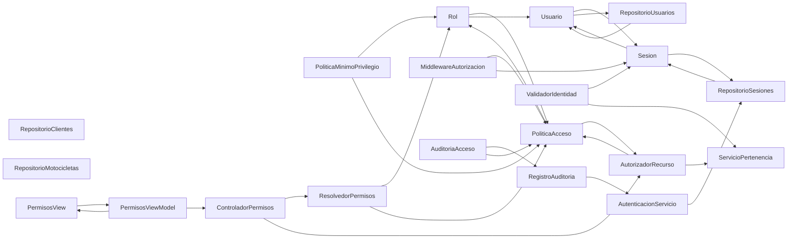

# US21 — Políticas de roles y permisos (transversal)

**Objetivo:** Denegar por defecto, validar rol y pertenencia en cada recurso privado y auditar cambios.  
**Estado:** propuesta de análisis para el equipo SSC; **no se afirma implementación**.  
**Fichas:** 20 componentes o conceptos seleccionados para US21, reutilizando definiciones del catálogo general.

[Volver al índice de CRC](README.md) · [Backlog V5](../backlog-v5.md) · [MVVM y arquitectura](../mvvm-y-arquitectura.md)

## Índice de las 20 fichas

| N.º | Clase / componente | Tipo |
| ---: | --- | --- |
| 01 | [Usuario](#crc-us21-01) | Entidad |
| 02 | [Rol](#crc-us21-02) | Valor de dominio |
| 03 | [PoliticaAcceso](#crc-us21-03) | Política de dominio |
| 04 | [ServicioPertenencia](#crc-us21-04) | Política de autorización |
| 05 | [Sesion](#crc-us21-05) | Entidad de aplicación |
| 06 | [AutenticacionServicio](#crc-us21-06) | Caso de uso |
| 07 | [RepositorioUsuarios](#crc-us21-07) | Puerto / repositorio |
| 08 | [RepositorioSesiones](#crc-us21-08) | Puerto / repositorio |
| 09 | [RepositorioClientes](#crc-us21-09) | Puerto / repositorio |
| 10 | [RepositorioMotocicletas](#crc-us21-10) | Puerto / repositorio |
| 11 | [MiddlewareAutorizacion](#crc-us21-11) | Middleware HTTP |
| 12 | [AutorizadorRecurso](#crc-us21-12) | Servicio de autorización |
| 13 | [ValidadorIdentidad](#crc-us21-13) | Validador de seguridad |
| 14 | [AuditoriaAcceso](#crc-us21-14) | Servicio de seguridad |
| 15 | [PoliticaMinimoPrivilegio](#crc-us21-15) | Política de seguridad |
| 16 | [ResolvedorPermisos](#crc-us21-16) | Servicio de dominio |
| 17 | [ControladorPermisos](#crc-us21-17) | Controlador HTTP |
| 18 | [PermisosView](#crc-us21-18) | Vista MVVM |
| 19 | [PermisosViewModel](#crc-us21-19) | ViewModel |
| 20 | [RegistroAuditoria](#crc-us21-20) | Servicio de infraestructura |

## Mapa de colaboraciones — vista de alto nivel

*Flechas calculadas a partir de los colaboradores explícitos de las fichas CRC. Los roles no se confunden con entidades.*

## Tarjetas CRC

### CRC-US21-01 · Usuario

| Campo | Especificación de diseño |
| --- | --- |
| **Tipo** | Entidad |
| **Responsabilidad** | Representar la identidad estable, el correo y el estado de una cuenta. |
| **Colaboradores** | `Sesion` · `RepositorioUsuarios` |
| **SOLID aplicado** | SRP — Mantiene invariantes propias sin responsabilidades de interfaz o acceso a datos. |
| **Límite de responsabilidad** | Separar decisiones de dominio de navegación y almacenamiento. |
| **Vinculación** | US21; validar en implementación y prueba antes de marcar completada. |

### CRC-US21-02 · Rol

| Campo | Especificación de diseño |
| --- | --- |
| **Tipo** | Valor de dominio |
| **Responsabilidad** | Identificar un conjunto autorizado de operaciones sin codificar privilegios en la vista. |
| **Colaboradores** | `PoliticaAcceso` · `Usuario` |
| **SOLID aplicado** | SRP — Mantiene invariantes propias sin responsabilidades de interfaz o acceso a datos. |
| **Límite de responsabilidad** | Separar decisiones de dominio de navegación y almacenamiento. |
| **Vinculación** | US21; validar en implementación y prueba antes de marcar completada. |

### CRC-US21-03 · PoliticaAcceso

| Campo | Especificación de diseño |
| --- | --- |
| **Tipo** | Política de dominio |
| **Responsabilidad** | Evaluar permisos por acción y recurso con denegación por defecto. |
| **Colaboradores** | `Rol` · `AutorizadorRecurso` |
| **SOLID aplicado** | OCP + SRP — La regla se concentra y puede sustituirse por otra estrategia cuando cambie el negocio. |
| **Límite de responsabilidad** | Los parámetros o reglas de negocio requieren validación y pueden cambiar. |
| **Vinculación** | US21; validar en implementación y prueba antes de marcar completada. |

### CRC-US21-04 · ServicioPertenencia

| Campo | Especificación de diseño |
| --- | --- |
| **Tipo** | Política de autorización |
| **Responsabilidad** | Comprobar en servidor que la motocicleta o expediente pertenece al cliente activo. |
| **Colaboradores** | `Cliente` · `Motocicleta` |
| **SOLID aplicado** | OCP + SRP — La regla se concentra y puede sustituirse por otra estrategia cuando cambie el negocio. |
| **Límite de responsabilidad** | Los parámetros o reglas de negocio requieren validación y pueden cambiar. |
| **Vinculación** | US21; validar en implementación y prueba antes de marcar completada. |

### CRC-US21-05 · Sesion

| Campo | Especificación de diseño |
| --- | --- |
| **Tipo** | Entidad de aplicación |
| **Responsabilidad** | Representar sesión, usuario, vigencia e invalidación verificable. |
| **Colaboradores** | `Usuario` · `RepositorioSesiones` |
| **SOLID aplicado** | SRP — Mantiene invariantes propias sin responsabilidades de interfaz o acceso a datos. |
| **Límite de responsabilidad** | Separar decisiones de dominio de navegación y almacenamiento. |
| **Vinculación** | US21; validar en implementación y prueba antes de marcar completada. |

### CRC-US21-06 · AutenticacionServicio

| Campo | Especificación de diseño |
| --- | --- |
| **Tipo** | Caso de uso |
| **Responsabilidad** | Orquestar login y logout delegando verificación, persistencia y autorización. |
| **Colaboradores** | `VerificadorCredenciales` · `RepositorioSesiones` |
| **SOLID aplicado** | SRP + DIP — Encapsula una capacidad y colabora por interfaces cuando depende de infraestructura. |
| **Límite de responsabilidad** | Separar decisiones de dominio de navegación y almacenamiento. |
| **Vinculación** | US21; validar en implementación y prueba antes de marcar completada. |

### CRC-US21-07 · RepositorioUsuarios

| Campo | Especificación de diseño |
| --- | --- |
| **Tipo** | Puerto / repositorio |
| **Responsabilidad** | Recuperar usuarios autorizadamente mediante un contrato abstraído del motor SQL. |
| **Colaboradores** | `Usuario` · `VerificadorCredenciales` |
| **SOLID aplicado** | DIP — El caso de uso consume un contrato; MySQL y sus consultas quedan en un adaptador. |
| **Límite de responsabilidad** | MySQL se mantiene detrás de una interfaz; no exponer tablas a la UI. |
| **Vinculación** | US21; validar en implementación y prueba antes de marcar completada. |

### CRC-US21-08 · RepositorioSesiones

| Campo | Especificación de diseño |
| --- | --- |
| **Tipo** | Puerto / repositorio |
| **Responsabilidad** | Persistir y consultar la vigencia de sesiones desde el servidor. |
| **Colaboradores** | `Sesion` · `RevocadorSesion` |
| **SOLID aplicado** | DIP — El caso de uso consume un contrato; MySQL y sus consultas quedan en un adaptador. |
| **Límite de responsabilidad** | MySQL se mantiene detrás de una interfaz; no exponer tablas a la UI. |
| **Vinculación** | US21; validar en implementación y prueba antes de marcar completada. |

### CRC-US21-09 · RepositorioClientes

| Campo | Especificación de diseño |
| --- | --- |
| **Tipo** | Puerto / repositorio |
| **Responsabilidad** | Persistir y consultar expedientes de clientes sin exponer SQL a casos de uso. |
| **Colaboradores** | `Cliente` · `GestorClientes` |
| **SOLID aplicado** | DIP — El caso de uso consume un contrato; MySQL y sus consultas quedan en un adaptador. |
| **Límite de responsabilidad** | MySQL se mantiene detrás de una interfaz; no exponer tablas a la UI. |
| **Vinculación** | US21; validar en implementación y prueba antes de marcar completada. |

### CRC-US21-10 · RepositorioMotocicletas

| Campo | Especificación de diseño |
| --- | --- |
| **Tipo** | Puerto / repositorio |
| **Responsabilidad** | Acceder a motocicletas y su relación con propietario vía contrato. |
| **Colaboradores** | `Motocicleta` · `GestorMotocicletas` |
| **SOLID aplicado** | DIP — El caso de uso consume un contrato; MySQL y sus consultas quedan en un adaptador. |
| **Límite de responsabilidad** | MySQL se mantiene detrás de una interfaz; no exponer tablas a la UI. |
| **Vinculación** | US21; validar en implementación y prueba antes de marcar completada. |

### CRC-US21-11 · MiddlewareAutorizacion

| Campo | Especificación de diseño |
| --- | --- |
| **Tipo** | Middleware HTTP |
| **Responsabilidad** | Bloquear rutas privadas sin sesión o permiso válido antes de llegar al caso de uso. |
| **Colaboradores** | `PoliticaAcceso` · `Sesion` |
| **SOLID aplicado** | SRP — Responsabilidad delimitada y colaboración explícita. |
| **Límite de responsabilidad** | Separar decisiones de dominio de navegación y almacenamiento. |
| **Vinculación** | US21; validar en implementación y prueba antes de marcar completada. |

### CRC-US21-12 · AutorizadorRecurso

| Campo | Especificación de diseño |
| --- | --- |
| **Tipo** | Servicio de autorización |
| **Responsabilidad** | Resolver permiso por acción, rol y pertenencia del expediente. |
| **Colaboradores** | `PoliticaAcceso` · `ServicioPertenencia` |
| **SOLID aplicado** | SRP + DIP — Encapsula una capacidad y colabora por interfaces cuando depende de infraestructura. |
| **Límite de responsabilidad** | Separar decisiones de dominio de navegación y almacenamiento. |
| **Vinculación** | US21; validar en implementación y prueba antes de marcar completada. |

### CRC-US21-13 · ValidadorIdentidad

| Campo | Especificación de diseño |
| --- | --- |
| **Tipo** | Validador de seguridad |
| **Responsabilidad** | Normalizar identidad autenticada de servidor y rechazar identificadores inválidos. |
| **Colaboradores** | `Sesion` · `ServicioPertenencia` |
| **SOLID aplicado** | SRP — Responsabilidad delimitada y colaboración explícita. |
| **Límite de responsabilidad** | Separar decisiones de dominio de navegación y almacenamiento. |
| **Vinculación** | US21; validar en implementación y prueba antes de marcar completada. |

### CRC-US21-14 · AuditoriaAcceso

| Campo | Especificación de diseño |
| --- | --- |
| **Tipo** | Servicio de seguridad |
| **Responsabilidad** | Registrar accesos denegados o cambios de permiso relevantes sin secretos. |
| **Colaboradores** | `RegistroAuditoria` · `PoliticaAcceso` |
| **SOLID aplicado** | SRP + DIP — Encapsula una capacidad y colabora por interfaces cuando depende de infraestructura. |
| **Límite de responsabilidad** | Separar decisiones de dominio de navegación y almacenamiento. |
| **Vinculación** | US21; validar en implementación y prueba antes de marcar completada. |

### CRC-US21-15 · PoliticaMinimoPrivilegio

| Campo | Especificación de diseño |
| --- | --- |
| **Tipo** | Política de seguridad |
| **Responsabilidad** | Garantizar que cada rol solo pueda pedir acciones explícitamente autorizadas. |
| **Colaboradores** | `Rol` · `PoliticaAcceso` |
| **SOLID aplicado** | OCP + SRP — La regla se concentra y puede sustituirse por otra estrategia cuando cambie el negocio. |
| **Límite de responsabilidad** | Los parámetros o reglas de negocio requieren validación y pueden cambiar. |
| **Vinculación** | US21; validar en implementación y prueba antes de marcar completada. |

### CRC-US21-16 · ResolvedorPermisos

| Campo | Especificación de diseño |
| --- | --- |
| **Tipo** | Servicio de dominio |
| **Responsabilidad** | Resolver permisos efectivos por rol, acción, recurso y contexto. |
| **Colaboradores** | `Rol` · `PoliticaAcceso` |
| **SOLID aplicado** | SRP + DIP — Encapsula una capacidad y colabora por interfaces cuando depende de infraestructura. |
| **Límite de responsabilidad** | Separar decisiones de dominio de navegación y almacenamiento. |
| **Vinculación** | US21; validar en implementación y prueba antes de marcar completada. |

### CRC-US21-17 · ControladorPermisos

| Campo | Especificación de diseño |
| --- | --- |
| **Tipo** | Controlador HTTP |
| **Responsabilidad** | Exponer operaciones limitadas de consulta y gestión de roles autorizadas. |
| **Colaboradores** | `ResolvedorPermisos` · `AutorizadorRecurso` |
| **SOLID aplicado** | SRP — Traduce HTTP en solicitudes de aplicación; no mezcla reglas ni consultas directas. |
| **Límite de responsabilidad** | El controlador delega reglas al caso de uso. |
| **Vinculación** | US21; validar en implementación y prueba antes de marcar completada. |

### CRC-US21-18 · PermisosView

| Campo | Especificación de diseño |
| --- | --- |
| **Tipo** | Vista MVVM |
| **Responsabilidad** | Mostrar matriz de permisos a administradores autorizados. |
| **Colaboradores** | `PermisosViewModel` |
| **SOLID aplicado** | SRP — Solo presenta información y captura interacción; no implementa autorización ni SQL. |
| **Límite de responsabilidad** | La vista no autoriza acciones ni habla con MySQL. |
| **Vinculación** | US21; validar en implementación y prueba antes de marcar completada. |

### CRC-US21-19 · PermisosViewModel

| Campo | Especificación de diseño |
| --- | --- |
| **Tipo** | ViewModel |
| **Responsabilidad** | Gestionar estados y cambios solicitados en interfaz de permisos sin conceder accesos. |
| **Colaboradores** | `PermisosView` · `ControladorPermisos` |
| **SOLID aplicado** | SRP + DIP — Gestiona estado de presentación; usa un cliente de datos en lugar de acceder a persistencia. |
| **Límite de responsabilidad** | No debe contener lógica de permisos ni persistencia. |
| **Vinculación** | US21; validar en implementación y prueba antes de marcar completada. |

### CRC-US21-20 · RegistroAuditoria

| Campo | Especificación de diseño |
| --- | --- |
| **Tipo** | Servicio de infraestructura |
| **Responsabilidad** | Conservar eventos sensibles con actor, momento y recurso sin datos secretos. |
| **Colaboradores** | `AutenticacionServicio` · `GestorMantenimiento` |
| **SOLID aplicado** | SRP + DIP — Encapsula una capacidad y colabora por interfaces cuando depende de infraestructura. |
| **Límite de responsabilidad** | Separar decisiones de dominio de navegación y almacenamiento. |
| **Vinculación** | US21; validar en implementación y prueba antes de marcar completada. |

## Validación de diseño

- [ ] Confirmar qué elementos requieren clase concreta, función, interfaz o DTO.
- [ ] Comprobar SRP: cada componente responde a un tipo de cambio.
- [ ] Verificar que los colaboradores realmente sean necesarios y que el dominio no importe la vista.
- [ ] Validar contratos con @kortCobein, @G43LEX y @fernandoohiti25 cuando cambien API o datos.
- [ ] Vincular implementación, pruebas y revisión al Issue de US21; registrar ajustes en el ADR.
