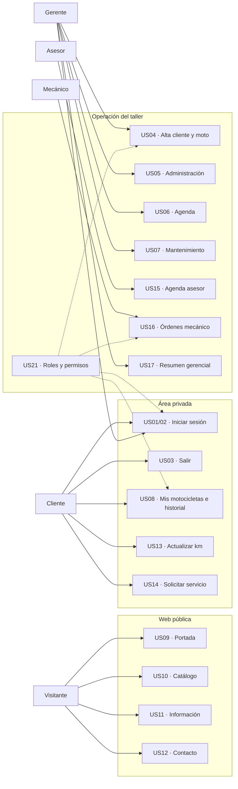

# Actores y funcionalidades — Mapa de casos de uso

Los actores operativos no equivalen a roles del equipo SSC. Este diagrama Mermaid es **un mapa funcional**, no sustituye los casos de uso textuales ni un diagrama UML formal.

Los módulos futuros US18, US19, US20 y US22 no se consideran parte del alcance mínimo hasta la aprobación del negocio.
