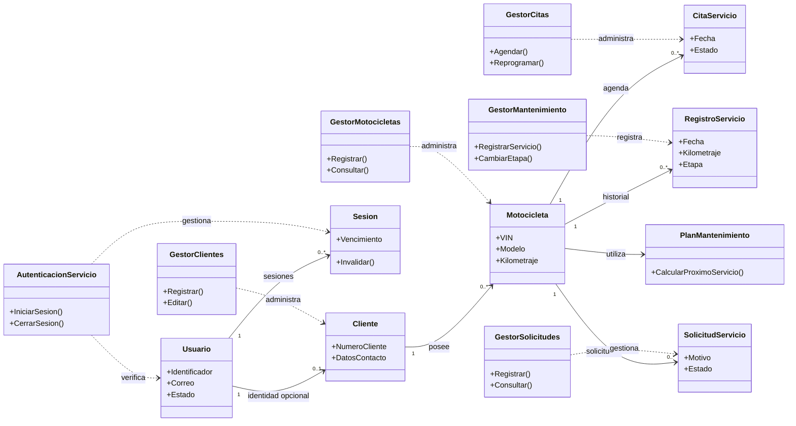

# Diagrama de clases — núcleo de dominio y aplicación

Vista conceptual de relaciones tomadas del catálogo CRC inicial. Los repositorios, controladores y ViewModels adicionales se detallan en [CRC extendidas](../crc/README.md). Las relaciones indican colaboración conceptual, no propiedades C# ya compiladas.

**Nota:** los detalles de multiplicidad y nombres concretos deberán revisarse con Gael al aprobar el esquema MySQL. Los roles gerenciales se modelan como permisos/composición, no necesariamente herencia.
