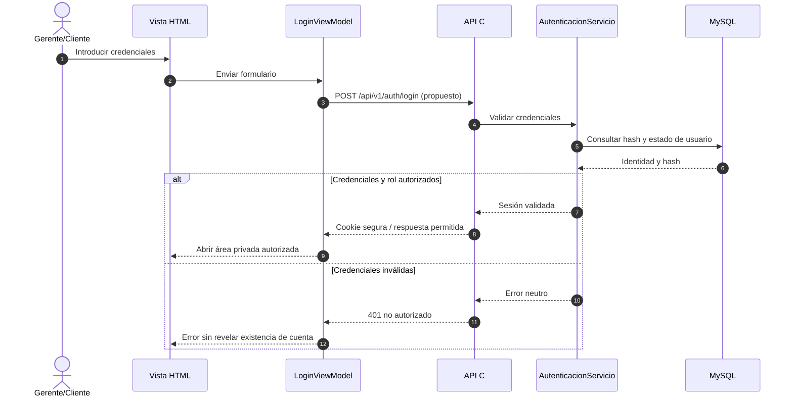
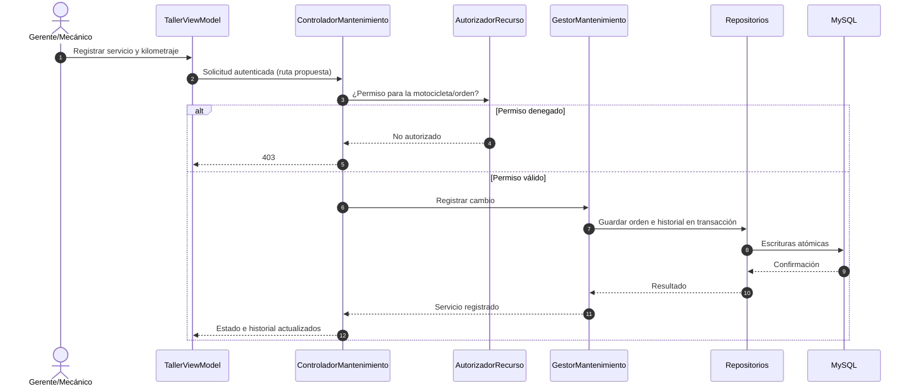
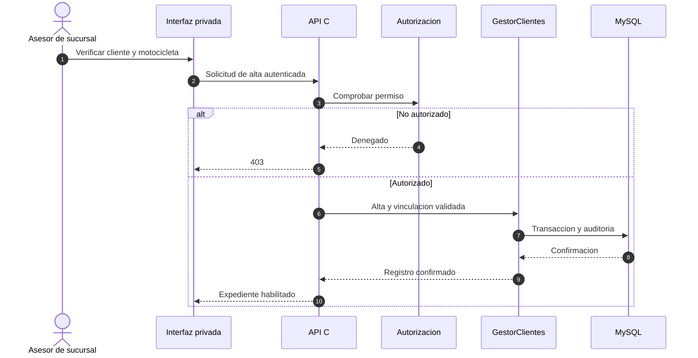

# Diagramas de secuencia — casos críticos

Los diagramas describen el comportamiento esperado. No suponen que el flujo de negocio ya esté implementado.

## US01 / US02 — Login autenticado y autorizado en servidor

## US07 — Registro de mantenimiento

Estos diagramas necesitan pruebas con datos ficticios y validación de permisos cuando exista el código.

## US04 — Registro presencial por asesor

La verificación de identidad y entrega de credenciales son procedimientos pendientes de aprobar con sucursal.
