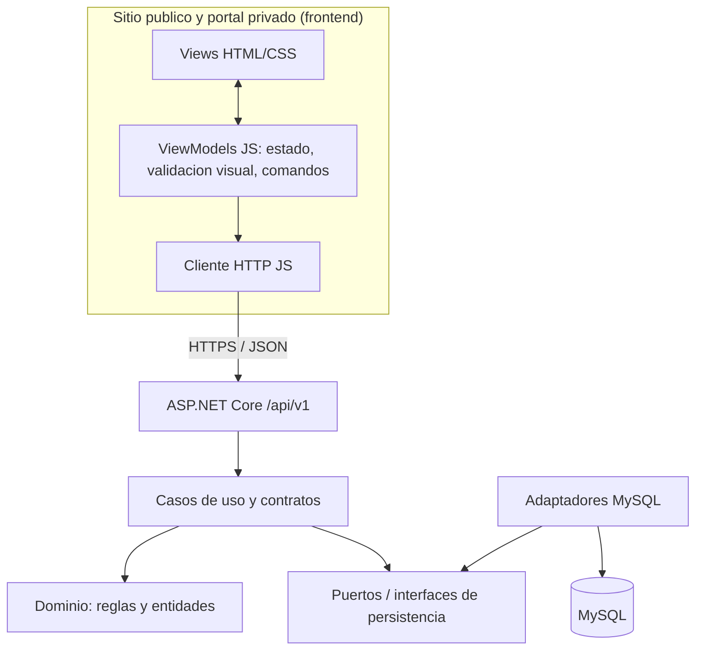

# Diseño de arquitectura y separación MVVM

## Alcance

Follow Motors es una **web HTML/CSS/JavaScript con API ASP.NET Core en C# y MySQL**, no una aplicación .NET MAUI. Se propone **MVVM ligero en el frontend** para separar vista, estado y modelo, sin introducir React, Angular o bibliotecas obligatorias. El patrón es un objetivo de refactorización, no algo ya implementado en todos los módulos.

## Diseño lógico propuesto

## Responsabilidades MVVM

| Componente | Contenido | Ejemplo |
| --- | --- | --- |
| **View** | Maquetación, accesibilidad, interacción visual | `frontend/views/motocicletas.html` (ruta futura) |
| **ViewModel** | Estado de carga, errores, comandos, selección y datos transformados | `frontend/js/viewmodels/motocicletas-viewmodel.js` (futuro) |
| **Model** | DTO de API, reglas de dominio tratadas en servidor; datos para presentar | `GET /api/v1/motorcycles` (contrato propuesto, no implementado) |

**Flujo de ejemplo:** el cliente selecciona una motocicleta → View llama al ViewModel → ViewModel pide datos al cliente HTTP → API valida sesión y pertenencia → MySQL responde → ViewModel convierte el resultado a un estado visible → View actualiza su presentación.

**Seguridad:** jamás confiar en visibilidad de un botón para autorizar acciones; el backend controla roles y pertenencia de cada recurso.

## SOLID, DRY, KISS y arquitectura modular

- **S:** identidad, agenda, motocicletas y mantenimiento tienen responsabilidades separadas.
- **O:** nuevas reglas de servicio deben poder agregarse sin alterar áreas ajenas.
- **L:** implementaciones de repositorios cumplen los contratos definidos.
- **I:** interfaces pequeñas por caso de uso, no una interfaz enorme.
- **D:** aplicación depende de abstracciones; infraestructura implementa acceso MySQL.
- **DRY:** validaciones de dominio compartidas de forma consistente.
- **KISS/YAGNI:** modularidad proporcional; no introducir microservicios ni CQRS complejo para CRUD trivial.

**CQRS ligero:** la separación de consultas y comandos es opcional donde simplifique reglas difíciles; no requiere dos bases ni event sourcing.

## Estado real frente al diseño

| Elemento | Estado |
| --- | --- |
| API de salud y prueba de conexión MySQL | Base funcional creada |
| HTML/CSS/JS y cliente HTTP inicial | Base creada |
| Estructura MVVM para todas las pantallas | Propuesta, no implementada |
| Servicios completos y permisos RBAC | Pendientes |
| Migraciones y modelo relacional de negocio | Pendientes de diseño y revisión |

## Decisiones que requieren aprobación

Estrategia de autenticación/sesión; reglas de propiedad y roles; disponibilidad de agenda; reglas de mantenimiento; migración de datos existentes; alojamiento del backend C#.

## Referencias

Microsoft. (s. f.). *Model-View-ViewModel (MVVM)*. Microsoft Learn. https://learn.microsoft.com/dotnet/architecture/maui/mvvm

OWASP Foundation. (s. f.). *Authorization cheat sheet*. OWASP Cheat Sheet Series. https://cheatsheetseries.owasp.org/cheatsheets/Authorization_Cheat_Sheet.html
