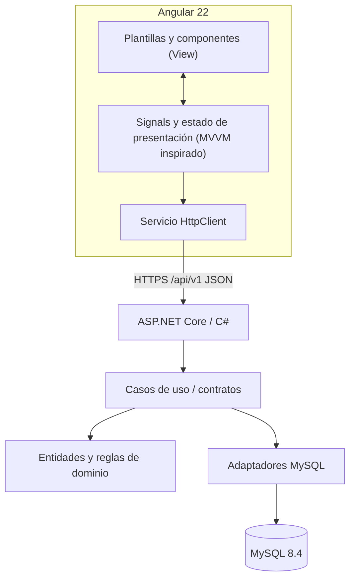

# Arquitectura — Angular, ASP.NET Core y MySQL

El stack definitivo es **Angular 22 + TypeScript**, **ASP.NET Core .NET 10 / C#** y **MySQL 8.4**.

## Arquitectura

La base Angular emplea componentes standalone, signals y HttpClient. **MVVM es una guía de separación de vista/estado/modelos, no un requisito para añadir una clase ViewModel en cada pantalla.** Angular no se conecta a MySQL y no decide autorización.

## Ejemplos reales de la base

- View: `frontend/src/app/app.html` y estilos `src/styles.css`.
- Estado: `frontend/src/app/app.ts` (signal de conectividad).
- API: `frontend/src/app/services/health.service.ts`.
- Backend: `backend/FollowMotors.Api/`.
- Desarrollo: proxy `frontend/proxy.conf.json` para `/api`.

## Políticas y SOLID

Los componentes y los servicios conservan responsabilidades diferenciadas, y los contratos TypeScript representan DTO HTTP. La API C# valida sesión, permisos y pertenencia de motos, mediante reglas de negocio y repositorios detrás de interfaces cuando aportan valor.

**Decisión comercial:** portal de asistencia/posventa, catálogo público solo informativo, alta presencial por asesor autorizado y portal privado para motos propias. [ADR-0005](adr/0005-alta-presencial-posventa.md).

## Estado de implementación

Existe una pantalla técnica Angular y comprobación de salud de la API. El esquema de negocio MySQL, login real, alta presencial, agenda, historial y garantías **no se consideran implementados**. El catálogo CRC es diseño propuesto, no clases ya desarrolladas.

## Referencias

Angular. (2026). *Version compatibility*. https://angular.dev/reference/versions

Angular. (s. f.). *Building Angular apps*. https://angular.dev/tools/cli/build

OWASP Foundation. (s. f.). *Authorization cheat sheet*. https://cheatsheetseries.owasp.org/cheatsheets/Authorization_Cheat_Sheet.html
