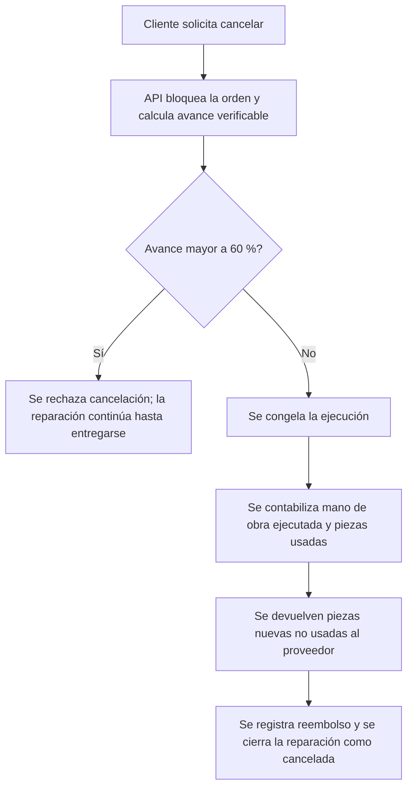

# 02 — Flujos funcionales

Estos son **flujos de negocio**. No se prescriben controladores ni tablas antes de desarrollar las historias.

## F01 — Registro presencial

1. Persona llega **sin cita**; empleado busca posible cuenta existente.
2. Verifica datos, crea cuenta e identificador único `@follow.motors`; no requiere contratación.
3. Entrega credenciales iniciales por canal presencial, sin correo ficticio como medio de recuperación.
4. Gerente puede desactivar la cuenta; el expediente permanece para trazabilidad.

## F02 — Alta y consulta de motocicleta

1. Personal identifica al cliente y registra moto de cualquier marca/procedencia.
2. Comprueba identificador único para evitar doble expediente y la vincula al cliente.
3. Cliente autenticado ve **solo** sus motos e información asociada. Una cuenta sin motos muestra estado vacío, no un error.

## F03 — Reserva y recepción

1. Gerente/personal define horarios y cupos de revisión.
2. Cliente con cuenta activa elige horario libre; la API confirma atómicamente y reserva cupo.
3. Personal ve la cita; si llega sin cuenta, la atención se registra presencialmente.
4. El ingreso al taller identifica moto, cliente, motivo y estado de recepción.
5. La cita **no** autoriza reparación ni genera cobro de reparación.

## F04 — Diagnóstico y acuerdo

1. Mecánico asignado revisa moto; recepción cobra **tarifa fija** ese día.
2. Diagnóstico queda registrado aunque el cliente decline la reparación.
3. Mecánico define trabajo, tareas, fecha estimada, mano de obra y piezas requeridas.
4. Cliente acepta **en persona** o declina. Si acepta, paga anticipo de mano de obra y piezas y recibe condiciones de garantía.
5. Se genera orden de servicio sin duplicar el cargo del diagnóstico.

## F05 — Refacciones y ejecución

1. El taller solicita piezas al proveedor; este no accede al sistema.
2. Personal registra llegada/costo de piezas; las no utilizadas permanecen selladas.
3. Sistema asigna mecánico por menor cantidad de atenciones abiertas (1 responsable por atención, N atenciones por mecánico).
4. Si faltan piezas, orden queda en espera; el mecánico trabaja en otras órdenes.
5. Mecánico registra ejecución verificable de tareas. Pesos del plan suman 100 %.
6. Al llegar a 25 % se muestra al cliente notificación de **avance significativo**, sin fingir que comenzó en ese instante.

## F06 — Cancelación

La **solicitud** no altera por sí sola el estado: se resuelve desde la API con una transacción que evita carreras con el avance. Si hay datos contradictorios se retiene para revisión, nunca se calcula un reembolso con un progreso inventado.

## F07 — Finalización y consulta

1. Mecánico termina tareas y confirma el trabajo; el tiempo estimado no lo cierra automáticamente.
2. Personal registra entrega; historial y vigencia de garantía del taller quedan consultables.
3. Portal presenta moto, próximas revisiones sugeridas, servicio, citas, estado de trabajos y garantía. Nunca expone registros de otros clientes.

## Estados funcionales sugeridos

| Registro | Estados principales |
| --- | --- |
| Cita | Confirmada, Atendida, Cancelada, No asistió |
| Atención | Recibida, Diagnosticada, Sin reparación, Contratada, Finalizada |
| Orden | Pendiente de piezas, Lista para trabajar, En ejecución, Cancelada, Terminada, Entregada |
| Refacción | Solicitada, Recibida sellada, Utilizada, Devuelta al proveedor |
| Tarea | Pendiente, En proceso, Terminada |
| Solicitud de cancelación | Recibida, Aprobada, Rechazada |
| Garantía del taller | Informada, Vigente, Vencida, Sin cobertura (según servicio) |

**No generar estados redundantes en el código:** estas etiquetas son vocabulario funcional, no enumeraciones definitivas.
